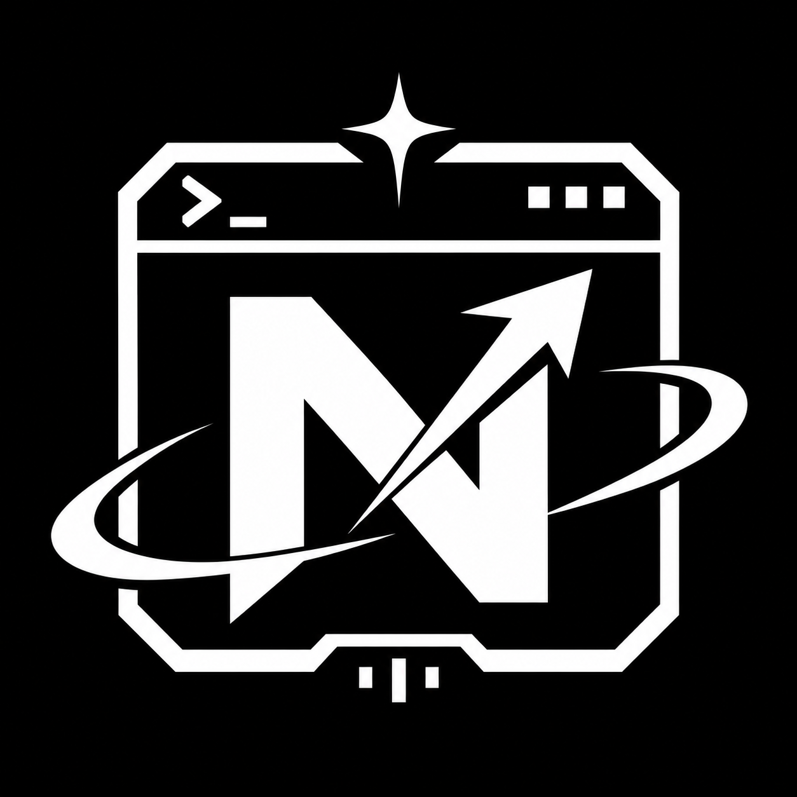
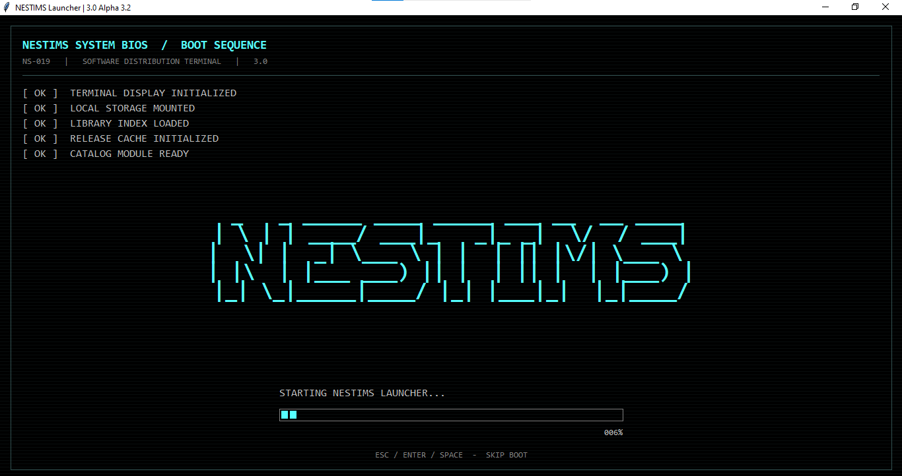
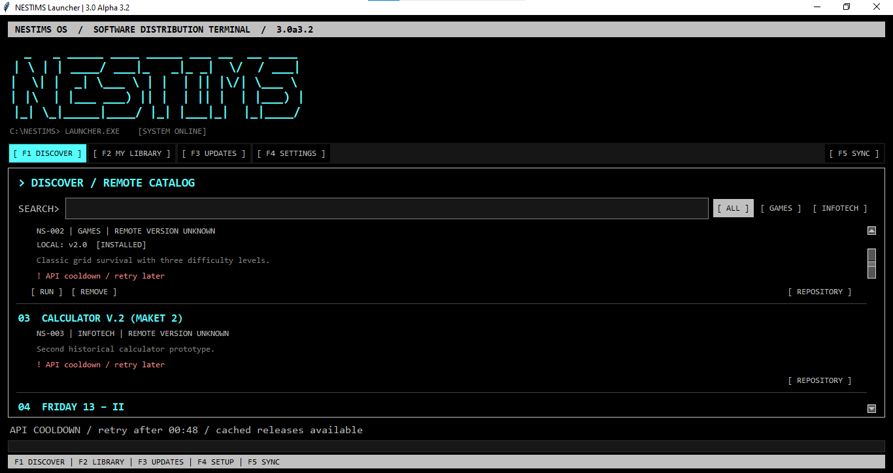
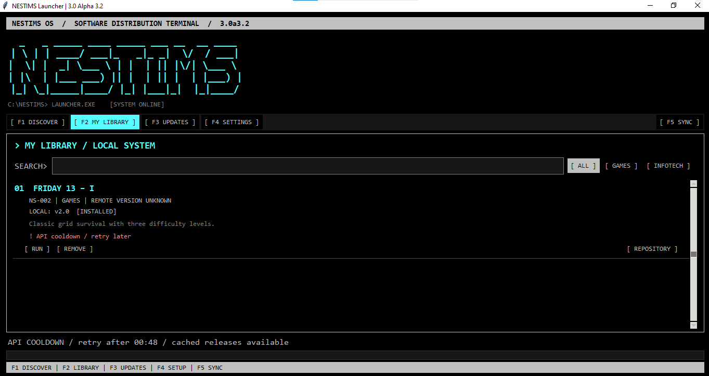
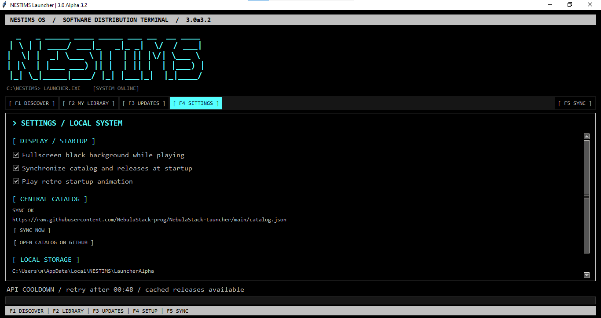
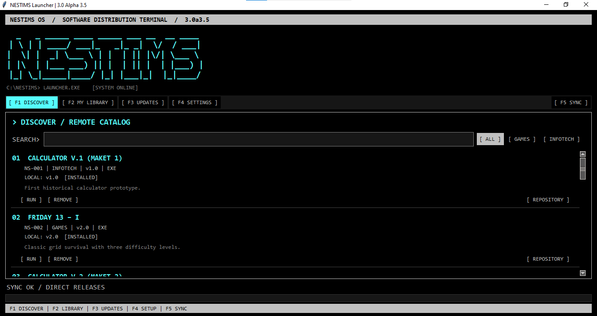

# NESTIMS Launcher

  

> One ecosystem. One launcher. Endless possibilities.

| Project Information | Details            |
| ------------------- | ------------------ |
| Project ID          | NS-023             |
| Direction           | Infotech           |
| Development Phase   | Phase III          |
| Version             | Alpha 3.5          |
| Platform            | Windows            |
| Language            | Python             |
| Status              | Active Development |

> 

## Overview

**NESTIMS Launcher** is a centralized desktop application designed to discover, install, launch, and update products within the NESTIMS ecosystem.

Unlike its predecessor, NebulaStack Launcher (NS-019), the new launcher introduces a centralized online product catalog, automated downloads, version management, and an integrated application library.

Inspired by classic DOS terminals and retro computer systems, NESTIMS Launcher combines a nostalgic visual experience with modern software distribution technologies.

## Key Features

- Centralized online product catalog
  
- Integrated library of installed applications
  
- Direct downloads from GitHub Releases
  
- Automatic detection of available updates
  
- Application installation and removal
  
- EXE and JAR package support
  
- SHA-256 file integrity verification
  
- Offline access to the cached catalog
  
- Search and category filtering
  
- Persistent local settings
  
- Fullscreen retro terminal interface
  
- Animated CRT-inspired startup sequence
  
- Optional fullscreen background during gameplay

## Interface

| Section     | Shortcut | Description                   |
| ----------- | -------- | ----------------------------- |
| Discover    | F1       | Browse available products     |
| My Library  | F2       | Manage installed applications |
| Updates     | F3       | Discover available updates    |
| Settings    | F4       | Configure the launcher        |
| Synchronize | F5       | Refresh the central catalog   |

## Architecture

NESTIMS Launcher uses a centralized JSON catalog to retrieve product information and release metadata.

The distribution process consists of five stages:

1. Synchronize the central catalog.
   
2. Retrieve available product versions.
   
3. Compare remote and installed versions.
   
4. Download the selected release.
   
5. Verify file integrity and install the application.

The catalog can be updated independently of the launcher itself, allowing new products and releases to become available without requiring a new launcher build.

## Technology Stack

- Python
- Tkinter
- JSON
- HTTP
- SHA-256
- GitHub Releases
- PyInstaller
- Git and GitHub

## Installation

1. Open the [Releases](https://github.com/NebulaStack-prog/NESTIMS-Launcher/releases/tag/v3.0a3.5) section of this repository.

2. Download the latest Windows executable.

3. Run NESTIMS Launcher.

4. Synchronize the product catalog.

5. Discover and install your preferred applications.

**Note:** A compatible Java runtime is required to launch JAR applications.

## Security and Reliability

NESTIMS Launcher validates release metadata and checks downloaded files using SHA-256 hashes when provided.

If the remote catalog is unavailable or invalid, the launcher can continue operating using the previously cached catalog.

## Development History

NESTIMS Launcher represents the next generation of software distribution within the NESTIMS ecosystem.

Its predecessor, [NebulaStack Launcher](https://github.com/NebulaStack-prog/NebulaStack-Launcher), was developed during Phase II and focused on managing locally available applications.

NS-023 introduces centralized distribution, product synchronization, and integrated update management.

## Screenshots

© NESTIMS
